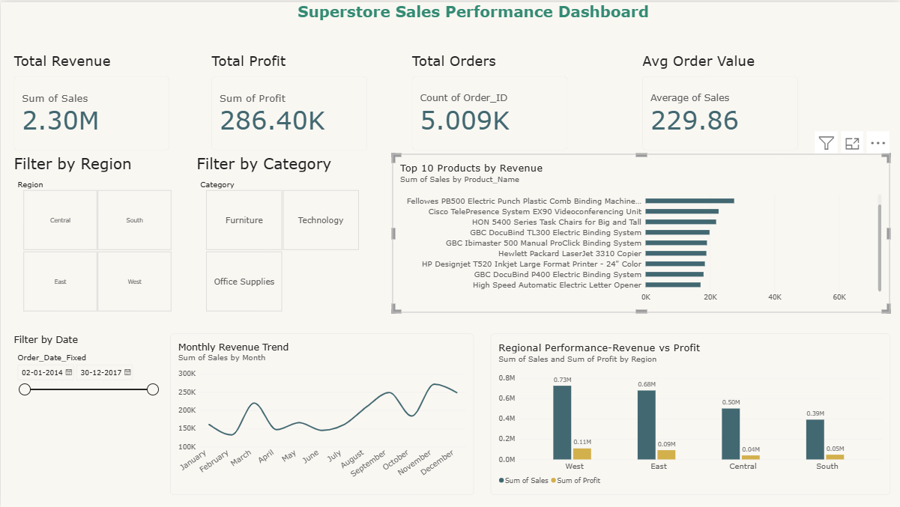

# Superstore Sales Analysis

An end-to-end data analytics project exploring sales performance, profitability, customer segments, product categories, and regional trends using SQL and Power BI.

The objective of this project is to transform raw Superstore sales data into meaningful business insights that can support better decision-making.

---

## 📊 Power BI Dashboard Preview



---

## 🎯 Project Objectives

- Analyze overall sales and profit performance.
- Identify top-performing regions and product categories.
- Understand customer segment performance.
- Identify profitable and loss-making subcategories.
- Analyze monthly sales trends.
- Present business insights through an interactive Power BI dashboard.

---

## 🛠️ Tools and Technologies

| Tool | Purpose |
|---|---|
| Microsoft Excel | Data inspection and preparation |
| MySQL | SQL-based data analysis |
| Power BI | Interactive dashboard development |
| CSV | Dataset storage and exchange |

---

## 📁 Repository Structure

```text
Superstore-Sales_Analysis/
│
├── 1_raw_data/
│   └── Sample - Superstore.csv
│
├── 2_cleaned_data/
│   └── Superstore_cleaned.csv
│
├── 3_sql_queries/
│   └── sales_analysis_queries.sql
│
├── 4_DashBoard/
│   ├── PowerBI_Dashboard_Preview.png
│   └── sql-powerbi.pbix
│
├── INSIGHTS_SUMMARY.md
└── README.md
```

---

## 📂 Dataset Information

The project uses the Superstore sales dataset obtained from Kaggle.

**Dataset Source:** [Superstore Dataset by Vivek468](https://www.kaggle.com/datasets/vivek468/superstore-dataset-final)

The dataset contains information about customer orders, products, sales, discounts, shipping, and profits.

### Dataset Details

| Attribute | Details |
|---|---|
| Total Records | 9,994 |
| Total Columns | 21 |
| Order Date Coverage | 2014–2017 |
| Data Format | CSV |

### Data Preparation

The original dataset was inspected and prepared before analysis.

The cleaned dataset was checked for missing values and duplicate records. The final cleaned dataset contains 9,994 records and 21 columns.

---

## 🔄 Project Workflow

1. **Data Collection**  
   Obtained the Superstore dataset from Kaggle.

2. **Data Cleaning and Preparation**  
   Inspected the dataset, prepared date columns, and checked data quality.

3. **SQL Analysis**  
   Used MySQL queries to analyze sales, profit, regional performance, product categories, and customer segments.

4. **Dashboard Development**  
   Developed an interactive Power BI dashboard to present important business metrics and trends.

5. **Business Insights**  
   Summarized key findings and recommendations based on the analysis.

---

## 📈 Key Business Insights

The following figures are from the project's analysis summary.

### Overall Performance

| Metric | Value |
|---|---:|
| Total Sales | $2,297,201.07 |
| Total Profit | $286,397.02 |
| Total Orders | 5,009 |
| Average Sales per Order | $229.86 |
| Overall Profit Margin | 12.47% |

### Regional Performance

| Region | Sales | Profit | Profit Margin |
|---|---:|---:|---:|
| West | $725,457.93 | $108,418.45 | 14.94% |
| East | $678,781.36 | $91,522.78 | 13.48% |
| Central | $501,239.88 | $39,706.36 | 7.92% |
| South | $391,721.90 | $46,749.43 | 11.93% |

**Observation:** The West region generated the highest sales and profit, while the Central region had the lowest profit margin.

### Category Performance

| Category | Sales | Profit | Profit Margin |
|---|---:|---:|---:|
| Technology | $836,154.10 | $145,454.95 | 17.40% |
| Office Supplies | $719,046.99 | $122,490.80 | 17.04% |
| Furniture | $741,999.98 | $18,451.27 | 2.49% |

**Observation:** Technology generated the highest profit. Furniture had a comparatively low profit margin despite generating substantial sales.

### Subcategory Insights

- Tables recorded a loss of $17,725.48.
- Bookcases recorded a loss of $3,472.56.
- Supplies recorded a loss of $1,189.10.
- Copiers generated a profit of $55,617.82.
- Accessories generated a profit of $41,936.64.

**Observation:** Some subcategories generated losses, indicating areas where pricing, discounting, and cost management could be reviewed.

### Customer Segment Performance

| Segment | Sales | Profit | Profit Margin |
|---|---:|---:|---:|
| Consumer | $1,161,401.34 | $134,119.21 | 11.55% |
| Corporate | $706,146.44 | $91,979.13 | 13.03% |
| Home Office | $429,653.29 | $60,298.68 | 14.03% |

**Observation:** The Consumer segment contributed the highest sales and total profit, while the Home Office segment achieved the highest profit margin.

### Top Products by Sales

1. Canon imageCLASS 2200 Advanced Copier — $61,599.82
2. Fellowes PB500 Electric Punch Plastic Comb Binding Machine with Manual Bind — $27,453.38
3. Cisco TelePresence System EX90 Videoconferencing Unit — $22,638.48

---

## 📊 Power BI Dashboard

The Power BI dashboard provides a visual overview of business performance, including:

- Total sales and profit.
- Order and sales metrics.
- Regional performance.
- Category and subcategory analysis.
- Customer segment performance.
- Sales and profitability trends.

**Dashboard File:** `4_DashBoard/sql-powerbi.pbix`

To explore the dashboard, download the `.pbix` file and open it using Microsoft Power BI Desktop.

---

## 🗄️ SQL Analysis

The SQL analysis is available in:

`3_sql_queries/sales_analysis_queries.sql`

The analysis covers:

- Overall sales and profit calculations.
- Total order analysis.
- Monthly sales analysis.
- Regional performance.
- Category and subcategory profitability.
- Customer segment analysis.
- Product performance.

### Running the SQL Queries

1. Install and open MySQL.
2. Create or select the project database.
3. Import the cleaned CSV into a table named `sales`.
4. Verify that the imported table's column names and data types match the SQL queries.
5. Execute the analysis queries.

**Important:** The SQL file includes table setup and data-modification statements. Review the script before executing it. In particular, do not execute `TRUNCATE TABLE sales` unless you intentionally want to empty the table. The cleaned CSV uses `Order_Date_Fixed` and `Ship_Date_Fixed` as its date-column names, so check the date-column references in the SQL script before running it.

---

## 💡 Business Recommendations

Based on the analysis:

- Review the profitability of the Furniture category.
- Investigate loss-making subcategories such as Tables and Bookcases.
- Study the sales strategies used in the high-performing West region.
- Focus on improving profitability in the Central region.
- Continue monitoring customer segment performance to identify growth opportunities.

These recommendations are based on descriptive analysis and do not establish causal relationships.

---

## 📚 Project Files

| File | Description |
|---|---|
| `README.md` | Project documentation |
| `INSIGHTS_SUMMARY.md` | Detailed business insights |
| `Sample - Superstore.csv` | Original dataset |
| `Superstore_cleaned.csv` | Cleaned dataset |
| `sales_analysis_queries.sql` | SQL analysis queries |
| `sql-powerbi.pbix` | Power BI dashboard file |
| `PowerBI_Dashboard_Preview.png` | Dashboard screenshot |

---

## 👨‍💻 Author

**Bharath M**

Bachelor of Engineering (BE)  
Computer Science and Engineering — Artificial Intelligence and Machine Learning

**College:** East West Institute of Technology

**GitHub:** [bharathm282006](https://github.com/bharathm282006)

---

## ⚠️ Disclaimer

This project is intended for educational and portfolio purposes. The findings and recommendations are based on the available dataset and descriptive analysis.
